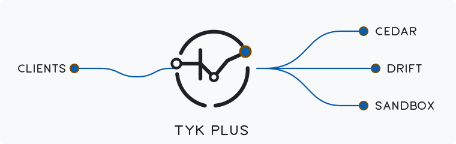
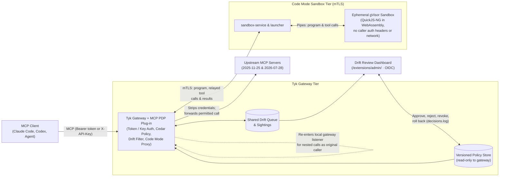

# Tyk Plus Plugins

<picture>
  <source media="(prefers-color-scheme: dark)" srcset="docs/branding/assets/header-dark.svg">
  
</picture>

**Policy-based Cedar authorization, upstream drift quarantine, and gVisor-sandboxed Code Mode for the Model Context Protocol (MCP), built on the open-source Tyk Gateway.**

Connecting AI agents directly to MCP servers creates three operational hazards:

1. **Coarse or gullible access control:** An agent that can reach an MCP server can usually see and call every tool on it, or the gateway blindly trusts the server's own `readOnlyHint` annotation.
2. **Silent upstream drift ("rug pulls"):** An MCP server that passed review yesterday can change a tool description today—adding hidden prompt instructions, new parameters, or look-alike Unicode characters that models obey.
3. **Context bloat and credential exposure in multi-step tasks:** Chaining tool calls across turns fills the model's context window with intermediate JSON, while typical code-execution sidecars run in environments that hold caller credentials.

**Tyk Plus Plugins** addresses all three in a single enforcement point around the open-source Tyk Gateway, with Docker Compose as the reference deployment and distroless, SLSA-attested container releases. [Waygate](https://github.com/chrisbennight/waygate) provides the standalone reference architecture for the governance model brought to Tyk here; the [initial capability epic](https://github.com/chrisbennight/tyk-plus-plugins/issues/1) tracks the roadmap.

**[Try the runnable lab](examples/README.md)** ·
**[Cedar policy & drift guide](gateway/policy/README.md)** ·
**[Drift review dashboard](admin/README.md)** ·
**[Code Mode](gateway/code-mode.md)** ·
**[Sandbox host](sandbox/README.md)** ·
**[Releases & verification](RELEASING.md)**

---

## What makes this gateway different

### 1. Cedar authorization that never takes an upstream's word for it

* **Default-deny with no built-in roles:** The gateway ships with no rules, an empty tool inventory, and no activation checks, so it denies every tool call until you write a rule in [`rules.cedar`](gateway/policy/README.md#rules) and—for upstream tools—add the tool to [`approved_tools.json`](gateway/policy/README.md#tools-and-reviewed-facts) (built-in `codemode.*` tools on Code Mode proxies are answered by the plug-in itself and authorized directly by your Cedar rules).
* **Reviewed facts vs. upstream claims:** Operators attach reviewed facts and tags to tools in [`approved_tools.json`](gateway/policy/README.md#tools-and-reviewed-facts). Upstream annotations (such as `readOnlyHint`) can only **narrow** an otherwise permitted call—a false read-only claim from an upstream never grants access.
* **Argument-level rules:** Cedar rules evaluate the caller's identity (OpenID Connect token claims for people, Tyk key metadata for service accounts), reviewed tool facts, and typed top-level call arguments (for example, allowing refunds only when `environment` is `test`). On proxies under [drift review](gateway/policy/README.md#drift-review), `tools/list` also leaves out any upstream tool that Cedar shows no arguments could ever let that caller invoke, keeping the model's context window focused.
* **Uniform refusals:** A call to a tool that is forbidden by Cedar rules, held by drift review, or an upstream tool not in `approved_tools.json` returns the exact same JSON-RPC error (`-32002: Tool call denied`), so callers cannot distinguish a policy denial from an unapproved tool.

### 2. Upstream drift quarantine and adversarial diff review

* **Cryptographic definition pinning:** Under [drift review](gateway/policy/README.md#drift-review), the gateway fingerprints every approved tool definition by the SHA-256 of its canonical JSON (ignoring top-level `_meta`) and server instructions (`initialize` and `server/discover`) by the SHA-256 of their text.
* **Cluster-wide hold on change:** Gateways compare calls against the definitions they last saw in a checked `tools/list` reply (or against approval alone before a tool has been seen in a list). Gateways sharing a drift directory write the latest definitions they see in `tools/list` replies from the background and read shared declarations on each refresh interval. Once a gateway sees an upstream `tools/list` reply add an unapproved tool or alter an approved definition, it refuses calls to that tool and hides (or serves the approved version of) its definition; peer gateways sharing the directory refuse calls within their refresh interval as sightings reach disk.
* **Adversarial diffing in the CLI and OIDC dashboard:** Reviewers inspect queued changes with [`cedar-policy drift`](gateway/policy/README.md#reviewing-changes) or in the browser-based [drift review dashboard](admin/README.md) (`/extensions/admin/`). Both show a labelled diff against the approved version, write out invisible characters (`⟨U+XXXX⟩`) and look-alike Unicode letters by code point, and hint when a new tool looks like a rename of a missing approved tool. The dashboard adds word-level change highlighting, advisory flags for instruction-like phrases, cross-tool references, file paths, URLs, and long text, and binds each form submission to the policy-set activation the page loaded against (whereas CLI commands decide against the set active when the command starts under the store lock). Every decision applies by exact fingerprint and is recorded in `decisions.log` (with the local user on the CLI, or the operator's OIDC-verified identity in the dashboard).

### 3. Sandboxed Code Mode with caller-authenticated loopback calls

* **Discover and compose:** On proxies where [Code Mode](gateway/code-mode.md) is enabled, callers find permitted tools across servers with `codemode.search` and `codemode.describe`, inspect runtime budgets with `codemode.limits`, and execute a short async JavaScript program with `codemode.execute` that can filter or combine multiple tool calls so only the program's returned value and `console` output reach the client's context.
* **One ephemeral gVisor + WebAssembly sandbox per run:** Programs run on a separate [sandbox host](sandbox/README.md) reached over mutual TLS. Each run starts a fresh gVisor sandbox (`runsc`, systrap platform) running QuickJS-NG compiled to WebAssembly, with a read-only root filesystem and no filesystem, environment, process, or non-loopback network access. When the launcher starts, it runs a self-test sandbox checking those container boundaries (loopback-only network, host-file invisibility, read-only root filesystem, and process isolation) and refuses runs if any check fails.
* **Caller authority preserved end to end:** The gateway keeps the caller's authentication headers and verified identity on the gateway side, sending only the program source, its `input`, limits, and nested tool results to the sandbox host. When a program calls a tool, the sandbox service relays the call over the mutual-TLS connection to the gateway plug-in, which sends an authenticated request to the gateway's own listener as the caller who started the run—applying the same Tyk authentication, rate limits, drift review, and Cedar rules as a direct call, and correlating every call in audit logs with a shared `code_mode_run` ID.

### 4. Atomic policy sets, lock-free reload, and verifiable releases

* **Checked before activation:** Rules, approved tools, approved instructions, and [activation checks](gateway/policy/README.md#activation-checks) (`checks.json`) are published together as an immutable, content-addressed policy set with `cedar-policy promote`. A candidate set whose activation checks do not all pass is rejected before it takes effect, and `cedar-policy activate` rolls back atomically.
* **Lock-free request path:** Gateways check the `active` pointer in the background and swap compiled sets atomically; live tool calls never wait for disk reads or validation. Measure compile and per-decision latency with [`cedar-policy bench`](gateway/policy/README.md#measuring-performance).
* **Hardened, attested containers:** Tagged releases build Tyk Gateway from source with the same Go toolchain as the plug-in and publish distroless Debian 13 images (`gateway`, `admin`, `sandbox`) to GitHub Container Registry. The release workflow blocks publication if any image contains a shell, a package manager, `runc`, or an uncovered critical or fixable high vulnerability, and attaches SLSA build provenance and SPDX SBOM attestations verifiable with `gh attestation verify`; see [RELEASING.md](RELEASING.md).

---

## Architecture at a glance



---

## Quick start: run the 5-server lab

To see Cedar authorization, argument rules, Code Mode across multiple servers, and upstream drift quarantine working immediately—without setting up an external identity provider or upstream MCP server—run the self-contained [examples deployment](examples/README.md):

```sh
cd examples
export TYK_GW_SECRET="$(openssl rand -hex 32)"
export TYK_GW_NODESECRET="$(openssl rand -hex 32)"
docker compose up --build -d
docker compose run --build --rm runner
```

Code Mode in the lab uses the production gVisor sandbox backend by default; on a development machine where gVisor cannot run, see [`examples/README.md`](examples/README.md#run) for the development `runc` override.

This starts the gateway, Redis, a local token issuer, the Code Mode sandbox host, and five FastMCP mock servers (`directory`, `payments`, `notes`, `older`, and `changing`), publishes an example policy set, and runs the automated verification suite against [`examples/expected.json`](examples/expected.json) across both supported MCP protocol versions.

From the running lab you can:
* **Connect Claude Code or Codex** with side-by-side analyst and admin credentials (`eval "$(docker compose run --build --rm runner env)"`); see [Connect Claude Code or Codex](examples/README.md#connect-claude-code-or-codex).
* **Walk through a live drift review** where an upstream tool description gains hidden Unicode characters and is held until reviewed with `cedar-policy drift`; see [Walk through a review](examples/README.md#walk-through-a-review).

Stop the lab with `docker compose down -v` (and if you exported `SANDBOX_BACKEND` or `COMPOSE_FILE` for the development backend, run `unset SANDBOX_BACKEND COMPOSE_FILE` before starting other Compose stacks in the same shell).

---

## Run your own gateway

At the repository root, [`compose.yaml`](compose.yaml) runs Tyk and Redis with the [MCP policy decision point plug-in](plugins/mcp-pdp/).

Set `MCP_UPSTREAM_URL` to your upstream’s MCP endpoint and configure your [Cedar authorization policy](gateway/policy/README.md). The gateway ships with no rules and denies every tool call until you add them. Connect MCP clients to `http://127.0.0.1:8080/mcp/` with a token from your identity provider or a Tyk key; see [callers](gateway/policy/README.md#callers).

```sh
export TYK_GW_SECRET="$(openssl rand -hex 32)"
export TYK_GW_NODESECRET="$(openssl rand -hex 32)"
docker compose up --build -d
```

Docker Compose refuses to start the gateway without both secrets. `TYK_GW_SECRET` authorizes Tyk's control API, which creates keys. `TYK_GW_NODESECRET` signs the notifications that gateways exchange through Redis, such as reload and key-change signals, so a client that can write to Redis cannot forge them. Every gateway that shares a Redis instance needs the same node secret. Supply both from your secret store rather than writing them into files, and keep Redis reachable only from the gateways.

In the same shell, stop the stack with `docker compose down`.

* **Drift review dashboard:** Start Compose with `docker compose --profile admin up -d` after setting your OpenID Connect provider variables; see [`admin/README.md`](admin/README.md#running-it).
* **Code Mode sandbox host:** Start the sandbox tier with `docker compose -f sandbox/compose.yaml up -d` after providing its mutual-TLS certificates and publishing port `8443` to the gateway (or connecting the containers on a shared network; see [`sandbox/README.md`](sandbox/README.md#run-it)), then point the gateway at it with the [Code Mode settings](gateway/code-mode.md#settings).

---

## Documentation map

| If you want to… | Read this |
| --- | --- |
| Configure OIDC tokens or Tyk keys, approve tools, write Cedar rules, and run activation checks | [Authorize MCP tool calls](gateway/policy/README.md) |
| Pin upstream definitions, detect tool or instruction changes, and review diffs on the CLI | [Drift review](gateway/policy/README.md#drift-review) |
| Run the browser-based OIDC drift review dashboard at `/extensions/admin/` | [Drift review dashboard](admin/README.md) |
| Let agents discover tools and run multi-call JavaScript programs | [Code Mode](gateway/code-mode.md) |
| Deploy and isolate the mutual-TLS gVisor and WebAssembly sandbox tier | [Code Mode sandbox host](sandbox/README.md) |
| Try the 5-server reference lab or test another gateway, server, or client | [Examples](examples/README.md) |
| Pull, verify, or cut signed distroless releases with SLSA provenance and SBOMs | [Releases](RELEASING.md) |
| Use the visual identity, color tokens, and SVG brand assets | [Design and visual identity](docs/design.md) |

---

## Supported MCP versions

The gateway supports MCP clients and upstream servers using protocol version `2025-11-25` (with `initialize` and sessions) or `2026-07-28` (stateless, with `server/discover`). A client that asks for `2026-07-28` uses it when the upstream supports it and otherwise falls back to `2025-11-25`, as the MCP specification requires. CI runs both client versions against an upstream that speaks both protocol versions, with plain and streamed replies; the same upstream keeping sessions; and an upstream that speaks only `2025-11-25`, with plain and streamed replies.
